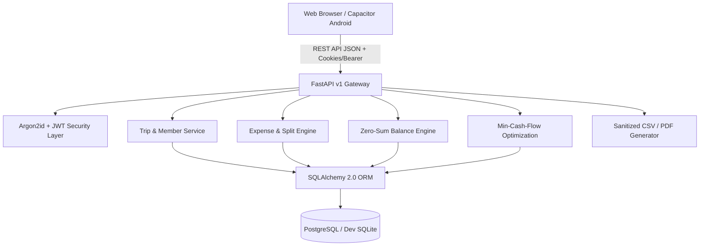

# ONNA-GO — System Architecture

**Tagline:** Ride Together. Vibe Together. Split Together.

---

## 1. Architectural Principles

1. **Web First, Native Ready**:
   - The React 19 frontend is built as a responsive web app and prepared for Capacitor Android distribution.
2. **Authoritative Backend**:
   - The backend owns all monetary rounding, remainder allocation, and authorization logic. No balance or split calculation is trusted from the client.
3. **Integer Minor Units**:
   - Floating-point representations of currency are strictly avoided. All money is stored in paise (INR) or cents (USD).
4. **Conservation of Balance**:
   - For every closed trip, $\sum_{u \in \text{Members}} \text{NetBalance}(u) \equiv 0$.
5. **Deterministic Debt Simplification**:
   - Bipartite greedy min-cash-flow algorithm iteratively matches maximum debtors with maximum creditors to minimize overall bank transfers.

---

## 2. High-Level Component Flow

